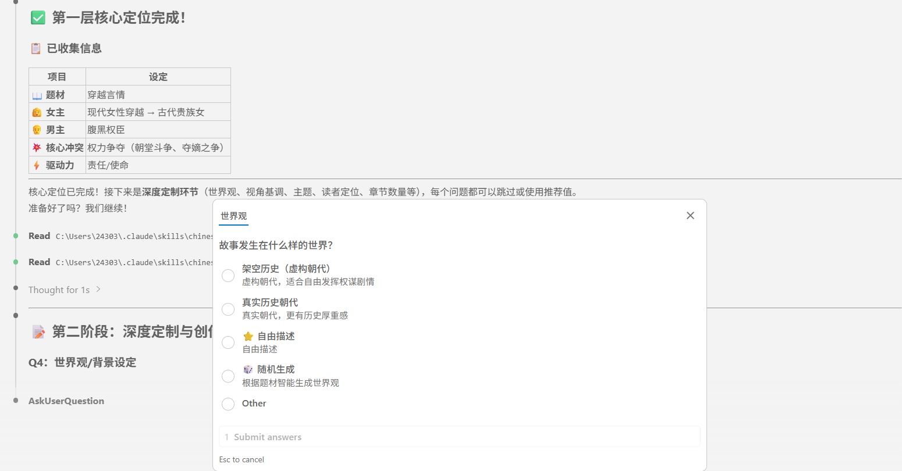
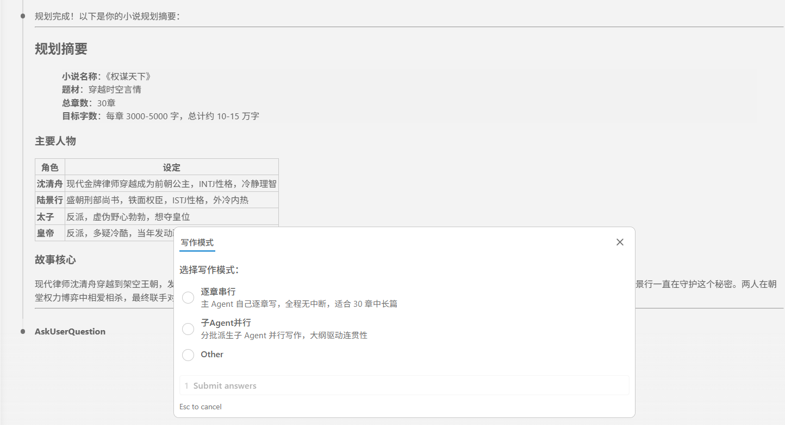
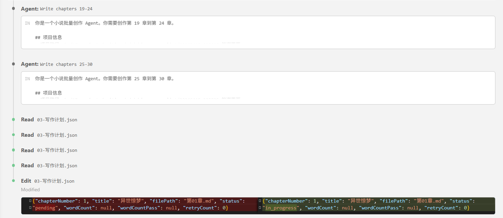
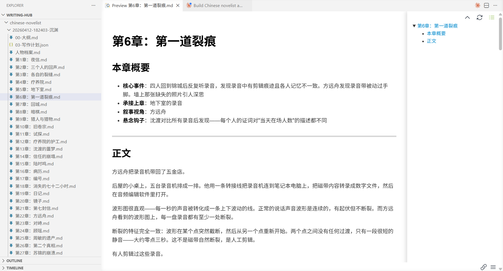
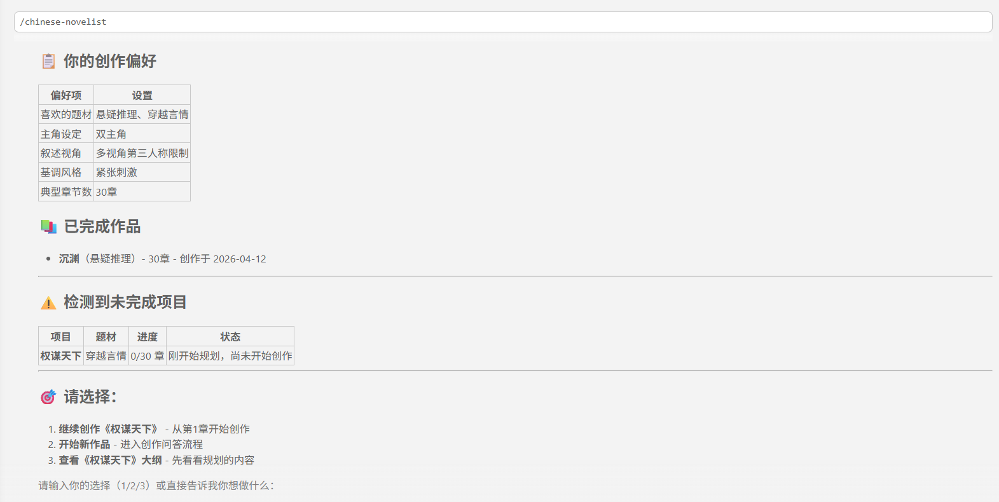
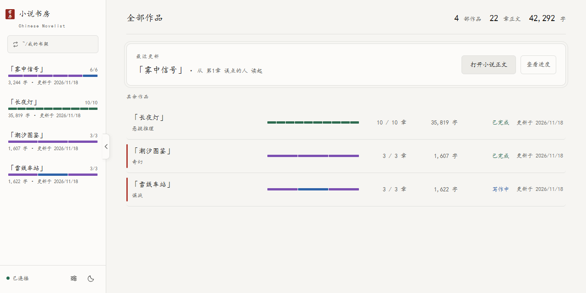
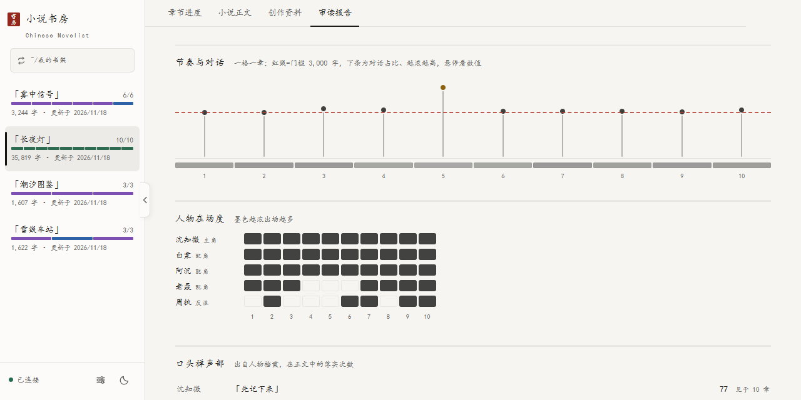
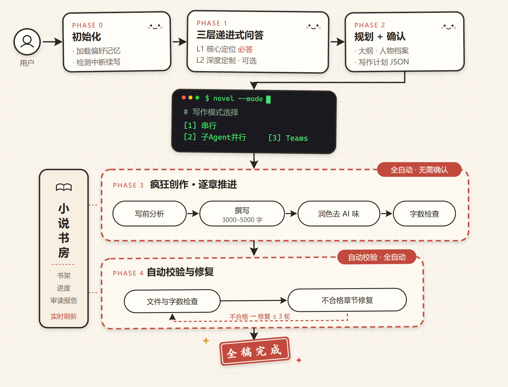

<div align="center">

# chinese-novelist skill

### 让 AI 为你写一部完整的中文小说

[](https://github.com/PenglongHuang/chinese-novelist-skill/releases)
[](https://claude.com/claude-code)
[](LICENSE)

> **v2.0 重构发布**：引入三层递进式问答、偏好记忆系统、中断续写、三种写作模式和自动校验修复！
>
> 查看 [v1.0 → v2.0 升级说明](https://github.com/PenglongHuang/chinese-novelist-skill/pull/10) 了解详情。

</div>


## 📖 为什么用这个？

脑子里有个故事，却总卡在“然后呢”？先定人物和大纲，再逐章写到完稿。面向 Coding Agent、Personal Agent 等各类 Agent：

- **智能问答** - 三层递进式问答，支持快速跳过和随机生成
- **偏好记忆** - 保存题材、视角和文风偏好，减少重复问答
- **中断续写** - 意外中断？自动检测并从断点继续
- **多种写作模式** - 串行 / 子Agent并行 / Agent Teams，按需选择
- **检查与润色** - 逐章审读连贯性与表达，脚本检查字数，不达标时修复
- **章节衔接** - 记录人物处境与事件后果，承接未解悬念
- **小说书房** - 本地只读书房：黑白墨格界面浏览进度、正文与创作资料，随文件变化自动更新

## 🚀 快速开始

安装 Skill：`npx skills add PenglongHuang/chinese-novelist-skill`

装好后，说一句：`使用 chinese-novelist 帮我写一部小说`

> **支持当下主流 Agent Harness**：Claude Code、Codex CLI、Gemini CLI、Cursor、Windsurf、Trae、CodeBuddy、Qwen Code、iFlow CLI、Aider、OpenCode、WorkBuddy 等均可直接安装使用，创作流程中的书房会在写作阶段自动启动，无需手动打开。

## 赞助商

<p align="center">
  <a href="https://www.infistar.cc/register?aff=29SS8B9E&ref_source=link">
    
  </a>
</p>

**chinese-novelist-skill × [Infistar.cc](https://www.infistar.cc/register?aff=29SS8B9E&ref_source=link)**

用这个技能包写长篇的朋友都知道：动辄几十万字的大纲回溯、多代理并行出章，额度往往比灵感先耗尽。

如果想放开手脚写长篇，推荐换上 Infistar：

- **零配置接入**：无需修改代码，Claude Code / 客户端只需换上 Base URL 与 Key 即可开工。
- **超低成本试错**：多模型价格极具优势。整卷重构、换文风重写、多代理并行爆肝不再肉疼。
- **全模型任意切**：Claude、GPT、Gemini、DeepSeek 一个 Key 全搞定，改个模型名就能对比打斗与感情戏表现。
- **国内顺畅使用**：RMB 直接结算，全模型支持验真防掺水。
- **专属福利**：通过[专属通道](https://www.infistar.cc/register?aff=29SS8B9E&ref_source=link)注册即送 $5 体验额度。建议领完拿同一份大纲让两个模型各试跑 3 章，感受文笔差异！

---

## ✍️ 使用过程

<table>
  <tr>
    <td align="center"><b>Phase 1 — 交互问答</b></td>
    <td align="center"><b>Phase 2 — 规划确认</b></td>
  </tr>
  <tr>
    <td></td>
    <td></td>
  </tr>
  <tr>
    <td align="center"><b>Phase 3 — 疯狂创作</b></td>
    <td align="center"><b>Phase 4 — 完稿输出</b></td>
  </tr>
  <tr>
    <td></td>
    <td></td>
  </tr>
</table>


## 🧠 创作记忆

每次创作后，Skill 会自动学习你的偏好：喜欢的题材类型、叙事风格、章节数量倾向、文字密度等。下次使用时，直接应用你的习惯，省去重复问答。

<p align="center">
  
</p>


## 📖 小说书房

写完的章节不再是散落的文件：启动本地书房，书架、章节进度、正文与创作资料一目了然，文件变动实时刷新；审读报告还会对全书做机械比对——节奏突变、人物断档、口头禅落实，尽收眼底。

<table>
  <tr>
    <td align="center"><b>书架 · 全部作品与进度</b></td>
    <td align="center"><b>审读报告 · 全书体检</b></td>
  </tr>
  <tr>
    <td></td>
    <td></td>
  </tr>
</table>


## 创作流程

<p align="center">
  
</p>


自动加载用户偏好，检测中断续写；三层问答后规划确认，随后全自动推进到完稿。各阶段细节见 [references/flows/](references/flows/)。

---

## 📂 输出样例

```
.chinese-novelist/
├── user-preferences.json              # 用户偏好（跨项目共享）
└── 20260412-143000-午夜列车/
    ├── 01-大纲.md                      # 故事概述、章节规划+ 设定词典
    ├── 00-人物档案.md                  # 主角、反派、配角档案
    ├── 02-写作计划.json                # 章节状态与字数记录
    ├── 03-文风基准.md                  # 文风指纹、基准段落、AI味负面清单
    ├── 99-章节摘要.md                  # 预建全章标题，每章收尾原位填写摘要
    ├── 第01章-最后一班列车.md
    ├── 第02章-消失的乘客.md
    └── ...
```

---

## 内置参考资料

### 流程文档（`references/flows/`）

| 文件 | 内容 |
|------|------|
| `phase0-initialization.md` | Phase 0：初始化与偏好加载 |
| `phase1-layer1-core.md` | Phase 1 Layer 1：核心定位问答（Q1-Q3） |
| `phase1-layer2-customize.md` | Phase 1 Layer 2：深度定制问答 |
| `phase2-planning.md` | Phase 2：规划与写作计划生成 |
| `phase3-writing.md` | Phase 3：疯狂创作（三种写作模式） |
| `phase4-validation.md` | Phase 4：自动校验与修复 |

### 写作指南（`references/guides/`）

| 文件 | 内容 |
|------|------|
| `chapter-guide.md` | 章节写作指南（含开头技巧、中文文学技法、连贯性保证、质量检查） |
| `hook-techniques.md` | 悬念设置技巧（13 种结尾钩子类型） |
| `character-building.md` | 人物塑造技法（侧重写作过程中的塑造技巧） |
| `dialogue-writing.md` | 对话写作规范（含节奏进阶、权力博弈） |
| `plot-structures.md` | 情节结构模板 |
| `content-expansion.md` | 内容扩充技巧（含分题材策略、实例对比） |
| `outline-template.md` | 大纲与设定词典模板 |
| `character-template.md` | 人物档案模板 |
| `chapter-template.md` | 章节文件模板 |

---

## 版本与路线

- **更新日志**：[Releases](https://github.com/PenglongHuang/chinese-novelist-skill/releases) — 每个版本的完整变更
- **Roadmap**：[ROADMAP.md](ROADMAP.md) — 已完成 / 进行中 / 计划中

---

## 💬 交流

- [GitHub Discussions](https://github.com/PenglongHuang/chinese-novelist-skill/discussions) — 使用心得、作品分享、功能想法
- [Issues](https://github.com/PenglongHuang/chinese-novelist-skill/issues) — 问题反馈与 bug 报告
- **微信**：交流与商务合作，扫码加我

<p align="center">
  
</p>

## 赞助

如果这个项目帮你写出了第一部小说，可以考虑[在爱发电赞助我](https://afdian.com/a/penglonghuang)，你的支持直接决定项目的更新速度。

## 许可

[MIT](LICENSE)
